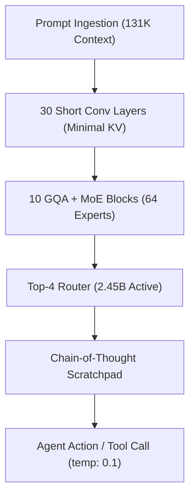

# ⚡ Liquid LFM2.5-24B-A2B: Edge Reasoning Revolution

<div align="center">

[](https://huggingface.co/LiquidAI/LFM2.5-24B-A2B)
[](https://huggingface.co/LiquidAI/LFM2.5-24B-A2B-GGUF)
[](https://playground.liquid.ai)
[](https://reddit.com/r/LocalLLaMA)
[](https://huggingface.co/LiquidAI/LFM2.5-24B-A2B/blob/main/LICENSE)

**A 24B-parameter hybrid reasoning giant that activates only 2.45B parameters per token — bringing true agentic power directly to local consumer hardware!**

</div>

---

## 🚀 The Scoop & Community Buzz

Liquid AI has officially launched **LFM2.5-24B-A2B**, the flagship and final model in the LFM2.5 family (scaling across two orders of magnitude from 230M to 24B). Instead of relying on a massive 70B+ brute-force architecture, Liquid AI fused **30 double-gated short convolution layers** with **10 Grouped-Query Attention (GQA)** blocks and a **64-expert Mixture-of-Experts (MoE)** routing mechanism.

### What Has Developers Buzzing:
* **🔥 MoE Speed with Tiny Compute:** Reasoning takes place across only 2.45B active parameters per token. You get deep Chain-of-Thought deliberation at blazing fast speeds.
* **⚡ Blistering Inference Speeds:** Benchmarks clock **184 tok/s** on an Apple M5 Max, **186 tok/s** decode on an RTX 3090, and a sustained **64 tok/s** at Q4 on consumer AMD CPUs with standard DDR4 RAM!
* **🏆 Smashes Rivals on Agent Benchmarks:** Beats Qwen3.6-35B-A3B on **LiveClaw** (48.09 vs 38.19) and scores a monstrous **27.69** on AutomationBench (3.2× higher than Qwen 35B).
* **🎯 Open Transparency:** Developers celebrated Liquid AI for publishing both their top victories and their losses (like SWE-Bench and GPQA Diamond) with honest y-axes starting at zero.

---

## 🧠 Architecture Blueprint: How LFM2.5 Thinks



### Technical Specs at a Glance

| Specification | Metric Value | Architectural Impact |
| :--- | :--- | :--- |
| **Total Parameters** | `24.0 Billion` | Dense knowledge bank stored across 64 specialized experts |
| **Active Parameters** | `2.45 Billion` | Only active weights computed per token, drastically cutting energy & latency |
| **Layer Composition** | `40 Layers` | 30 double-gated short convolutions + 10 Grouped Query Attention (GQA) blocks |
| **MoE Routing** | `Top-4 of 64` | Dynamically selects the 4 best-suited expert networks for each token |
| **Context Window** | `131,072 Tokens` | Handles deep documentation, multi-turn tool harnesses, and codebase inspection |
| **Training Budget** | `36 Trillion Tokens` | Multi-language polyglot dataset covering 16 major global languages |
| **Default Sampling** | `temp: 0.1, top_k: 50` | Calibrated strictly for high-precision deterministic reasoning and tool calls |

---

## ⚖️ Real-World Challenges & Hardware Math

While LFM2.5-24B-A2B is exceptionally fast, local deployment requires knowing your memory targets:

| Quant Format | Weight File Size | Minimum Required VRAM / RAM | Practical Hardware Target |
| :--- | :---: | :---: | :--- |
| **FP16 (Unquantized Base)** | ~48.0 GB | 48 GB VRAM | Dual RTX 3090 / 4090 or A6000 |
| **QAD-Q4_0 (Official Distilled)** | ~14.4 GB | 12 - 16 GB VRAM | RTX 3090, 4080, Apple M-Series Unified |
| **Q4_K_M (Balanced)** | ~14.8 GB | 16 GB VRAM | RTX 4070 Ti / 5070 + DDR4 RAM offload |
| **Q4_K_XL (Offload)** | ~14.5 GB | 6 GB VRAM + 16 GB RAM | RTX 2060 budget PC (20-25 tok/s sustained) |
| **IQ3_XXS / Q2_K** | ~9.8 GB | 8 - 10 GB VRAM | Extreme budget setups / 24GB Android devices |

> **Distillation Advantage:** Liquid AI trained the official **QAD-Q4_0** (Quantization-Aware Distillation) checkpoint to recover the accuracy lost to 4-bit quantization, giving you FP16 quality at ~14.4 GB.

---

## 🧪 6 Zero-Dependency Prompts to Test on playground.liquid.ai

You can test LFM2.5-24B-A2B right now for free at **[playground.liquid.ai](https://playground.liquid.ai)** without installing any local weights or uploading files. 

Here are **6 innovative, zero-dependency test prompts** designed to expose the model's spatial reasoning, code generation, algorithm state tracking, and deterministic formatting:

### 1. Zero-Dependency Text-Based Visualizations & Layout
> **What this tests:** Spatial reasoning, constraint tracking, and ASCII mathematical scaling without visual hallucination.

**Prompt:**
```text
I manage a small warehouse holding four types of inventory: 450 units of Type A, 200 units of Type B, 150 units of Type C, and 50 units of Type D.

I need a single response that includes the following:

A Markdown Table: Show the unit counts and their percentage of the total inventory.

A Text-Based Bar Chart: Create a horizontal bar chart using text symbols. Each block symbol (e.g., █) must represent exactly 25 units.

A Text-Based 'Heatmap' Grid: Represent the entire 850-unit inventory as a 10x85 text grid. Assign a unique, single character (like #, @, *, +) to each inventory type. Fill the grid sequentially (starting with all Type A characters, then Type B, etc.) so I can visually see the proportion of space they occupy.
```

---

### 2. Multi-Component HTML/JS Dashboard (Zero-Install)
> **What this tests:** Frontend DOM generation, pure native HTML5 `<canvas>` math, and single-file data reactivity without external CDNs.

**Prompt:**
```text
Write the complete code for a single-file HTML dashboard that I can save to my desktop and open in a browser immediately. Do not use any external dependencies, frameworks (like React or Vue), or CDN links for charting libraries.

The dashboard must include:

Clean CSS Styling: A modern, clean layout with a sidebar on the left and a main content area.

Interactive Data Entry Form: A simple form in the sidebar where I can input a 'Project Name' and an 'Estimated Hours' number, with a 'Submit' button.

Dynamic HTML Table: When I click 'Submit', the data must instantly append as a new row in a table displayed in the main content area.

Native Canvas Visualization: Below the table, use the native HTML5 <canvas> API (write the pure JavaScript yourself) to draw a simple vertical bar chart that updates automatically to reflect the 'Estimated Hours' data currently in the table. Start the table with two dummy data rows so the chart isn't empty upon loading.
```

---

### 3. Complex Algorithmic Visualization (Python Zero-Dependency)
> **What this tests:** Algorithmic state persistence, 2D grid matrix manipulation, and terminal rendering loops using standard library only.

**Prompt:**
```text
Write a standard Python script (no external libraries like numpy or pygame) that implements Conway's Game of Life in the terminal.

The script must:
1. Initialize a 20x40 grid with a classic glider pattern and a blinker oscillator.
2. Advance through 15 generations with a 0.2-second pause between steps.
3. Clear the terminal between generations and render live cells as '■' and dead cells as '·'.
4. Include clean wrap-around boundary logic (toroidal grid).
```

---

### 4. Interactive DOM Manipulation (Single-File Kanban)
> **What this tests:** State transitions across columns, dynamic event listeners, and clean UI styling in pure JavaScript.

**Prompt:**
```text
Write the complete code for a single-file HTML 'Kanban Board' application (like Trello). It must have three columns: 'To Do', 'In Progress', and 'Done'. I need to be able to add new text cards to the 'To Do' column, and then click a 'Move Right' button on any card to shift it to the next column. Include all HTML, CSS styling, and raw JavaScript logic in this one file, without any external dependencies.
```

---

### 5. Multi-Layered SVG Speedometer Gauge (Zero-Dependency)
> **What this tests:** Coordinate geometry math, SVG path definitions (`d="M ... A ..."`), needle rotation math, and color zoning.

**Prompt:**
```text
Generate the raw SVG code (wrapped in a basic HTML file) for a custom 'Project Health' speedometer gauge. The gauge should be an arc from 0 to 100. Draw the arc with three color zones: Red (0-33), Yellow (34-66), and Green (67-100). Draw a needle pointing to exactly 78. Include text labels for '0', '100', and a bold '78% - Healthy' in the center. Do not use any external charting libraries; write the native SVG paths and text elements yourself.
```

---

### 6. Complex Mathematical ASCII Art (Python)
> **What this tests:** Continuous function approximation, discrete padding calculations, and phase tracking using pure Python math.

**Prompt:**
```text
Write a standard Python script (no external libraries like numpy or matplotlib) that calculates and prints a text-based ASCII sine wave in the terminal. The wave should flow vertically down the screen for 40 lines. The amplitude should be 20 characters wide, and it should complete exactly two full cycles (periods) within those 40 lines. Use the * character to draw the curve, and pad the left side with spaces to position it correctly.
```

---

## 🛠️ How to Run LFM2.5-24B Locally

### 1. Using llama.cpp (CLI)
Download and run the official distilled checkpoint directly:

```bash
# Direct run via llama-cli with official hyperparameters
llama-cli -hf LiquidAI/LFM2.5-24B-A2B-GGUF \
    --hf-file LFM2.5-24B-A2B-QAD-Q4_0.gguf \
    --temp 0.1 \
    --top-k 50 \
    --repeat-penalty 1.05 \
    --ctx-size 131072 \
    --flash-attn
```

### 2. High-Performance GPU Inference with vLLM / SGLang

```bash
# Launch high-throughput OpenAI-compatible server
python -m vllm.entrypoints.openai.api_server \
    --model LiquidAI/LFM2.5-24B-A2B \
    --tensor-parallel-size 1 \
    --max-model-len 32768 \
    --trust-remote-code
```

---

## 🔭 5 Future Developments to Watch

1. **🚀 DSpark Speculative Drafter:** Liquid AI confirmed a native DSpark draft model for SGLang is currently in training, which will push generation speeds past 300 tok/s locally.
2. **👁️ Vision Tower Integration:** While the 24B-A2B is text-only today, Liquid's hybrid architecture is slated to receive a multi-modal SigLIP-based vision adapter.
3. **💻 On-Device Phone Agents:** With community IQ2/IQ3 quants shrinking memory down to ~9 GB, enthusiasts are testing local agent loops on 24GB Android devices.
4. **🔧 Tool-Calling Harness Expansion:** Native integration recipes for PicoClaw, OpenClaw, and Hermes Agent harnesses are being actively tuned by the open-source community.
5. **🪪 License Evolution:** Community discussions are pressing Liquid AI to align future checkpoint derivatives closer to standard Apache 2.0 open-source licensing.

---

## 🔗 Official Links & Reference Sources

* **Hugging Face Model Card:** [LiquidAI/LFM2.5-24B-A2B](https://huggingface.co/LiquidAI/LFM2.5-24B-A2B)
* **Official GGUF Checkpoints:** [LiquidAI/LFM2.5-24B-A2B-GGUF](https://huggingface.co/LiquidAI/LFM2.5-24B-A2B-GGUF)
* **Free Online Playground:** [playground.liquid.ai](https://playground.liquid.ai)
* **Official Documentation:** [docs.liquid.ai](https://docs.liquid.ai)
* **LocalLLaMA Megathread:** [Reddit Discussion](https://reddit.com/r/LocalLLaMA)

---

## 🏷️ Keywords & Tags

`liquid-ai` `lfm2.5` `lfm-2.5-24b-a2b` `edge-ai` `mixture-of-experts` `moe` `local-llm` `gguf` `llama-cpp` `ollama` `vllm` `sglang` `on-device-ai` `open-weights` `ai-agents`

